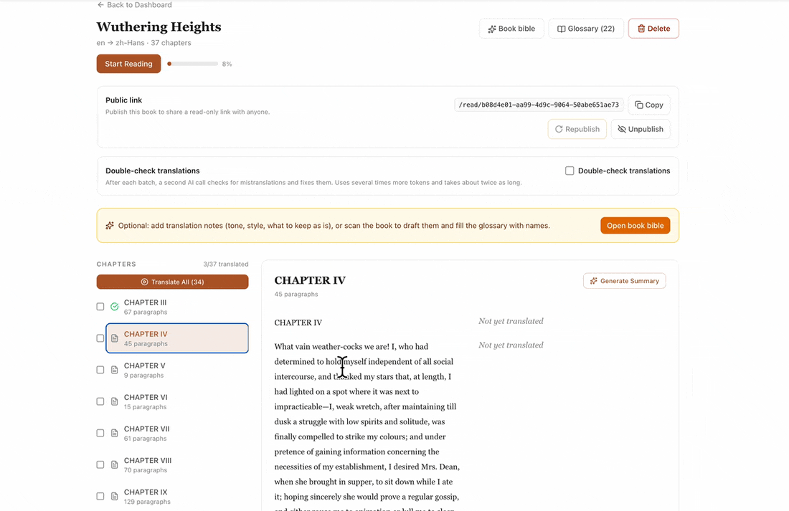
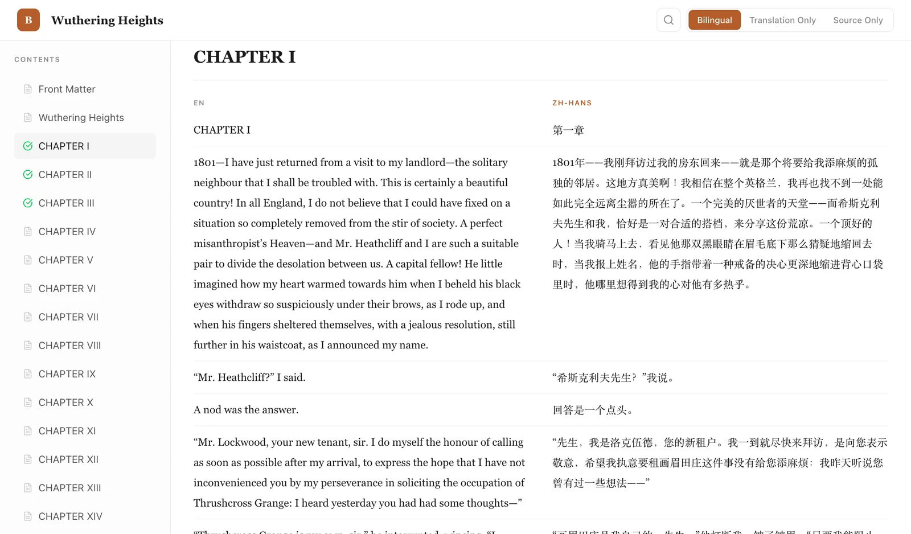
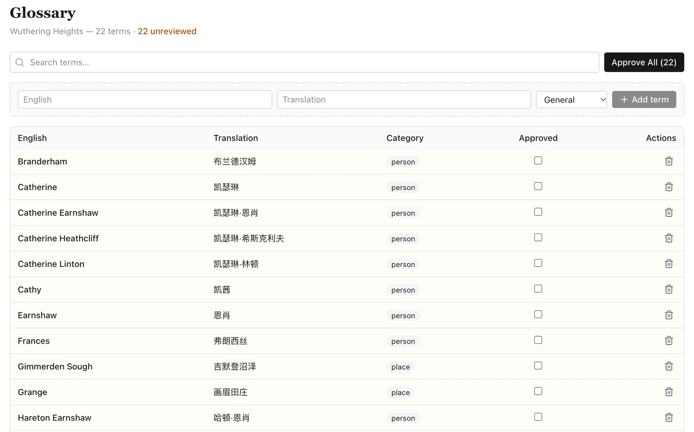
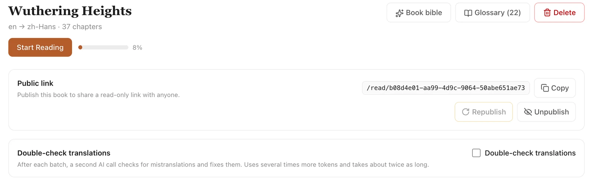
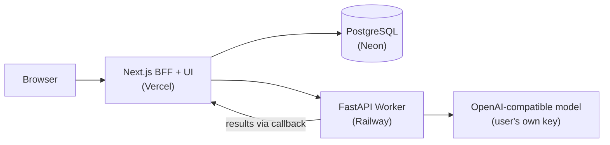

# BookBridge

**Translate EPUB and TXT books with an AI model of your choice, and keep character names consistent from the first chapter to the last.** Built for long stories, where pasting chapters into a chatbot falls apart.



**Try it:** [bookbridge-henna.vercel.app](https://bookbridge-henna.vercel.app) · **Read a sample without signing up:** [*Wuthering Heights*, Chapter I in English and Chinese](https://bookbridge-henna.vercel.app/read/b08d4e01-aa99-4d9c-9064-50abe651ae73#ch-3)

---

## What it does

**Your own translation notes.** Tell it how you want the book translated, like the tone, the style, or what to leave as is. Optionally, let it scan the whole book first and draft notes on the plot and characters for you.

<table>
  <tr>
    <td width="36%"><b>Context for every paragraph.</b> Each paragraph is translated with the names that appear in it and the few paragraphs before it, so chapter 30 still knows what chapter 1 decided.</td>
    <td></td>
  </tr>
  <tr>
    <td><b>You control the names.</b> Character and place names go into an editable list. Change a name once and every chapter follows.</td>
    <td></td>
  </tr>
  <tr>
    <td><b>Optional double-check.</b> Turn it on per book to have a second AI pass catch mistranslations and fix them. Slower and uses more tokens.</td>
    <td></td>
  </tr>
</table>

Also: search the original and the translation, export a bilingual EPUB (side by side or paragraph by paragraph) or Markdown, and share a read-only link.

## Some ways to use it

- **Untranslated web novels.** Read the ones nobody has translated yet.
- **Language practice.** Read something you actually like, original and translation side by side.
- **Just a few chapters.** No need to translate the whole book.
- **AO3 fics.** Download a fic as EPUB from AO3 and upload it here.
- **Take it with you.** Export a bilingual EPUB, or share a reading link.

You bring your own API key (OpenAI, DeepSeek, or any OpenAI-compatible provider); translation costs are billed by your provider. It's machine translation, so it won't be perfect, and translations are for personal reading. If you want to share a translation of someone's fic, ask the author first.

## How it works

The hard part of translating a novel with an LLM is not any single paragraph; it's keeping hundreds of them consistent with each other.

- **Paragraph by paragraph, aligned.** A chapter is sent in batches with each paragraph tagged `<<<1>>>`, `<<<2>>>`, … and the reply is split back on the same markers, so every translation lines up with its source paragraph (that's what makes the side-by-side reader possible). If the counts don't match, the batch is halved and retried, down to a single paragraph.
- **A name list of people and places only.** Common words and names that already have a standard translation are left out. Before each batch, the names that occur in it are found by exact matching (word boundaries, plurals and possessives, case rules) rather than embeddings, so a name that is in the paragraph is never missed, and only those names go into the prompt.
- **A sliding context window.** Each batch also sees the previous few paragraphs with their translations, across chapter boundaries.

<details>
<summary><b>Run it locally</b></summary>

You need Python 3.11+, Node 20+, a PostgreSQL database and a [Clerk](https://clerk.com) app.

**Worker** (FastAPI, from the repo root):

```bash
python -m venv .venv && source .venv/bin/activate
pip install -e ".[dev]"
cp .env.example .env   # TRANSLATION_PROVIDER=mock runs without an API key
uvicorn bookbridge.worker_api.main:app --reload --port 8000
```

Set `CALLBACK_BASE_URL=http://localhost:3000` and a `WORKER_CALLBACK_SECRET` in `.env`; the Worker posts results back to the web app.

**Web app** (Next.js, in `bookbridge-next/`), with a `.env.local` containing `DATABASE_URL`, `NEXT_PUBLIC_CLERK_PUBLISHABLE_KEY`, `CLERK_SECRET_KEY`, `WORKER_URL=http://localhost:8000` and the same `WORKER_CALLBACK_SECRET`:

```bash
npm install
npx prisma migrate deploy
npm run dev
```

**Tests:** `pytest tests/` for the Worker, `npm test` (Vitest) and `npx playwright test` in `bookbridge-next/`.

</details>

## Tech stack



| Layer | Technology |
|---|---|
| Web app and API (BFF) | Next.js 16 App Router, React 19, Tailwind CSS 4, Zod |
| Auth | Clerk |
| Database | PostgreSQL (Neon) via Prisma |
| Translation Worker | Python 3.11, FastAPI, any OpenAI-compatible chat API |
| Tests | pytest, Vitest, Playwright |
| CI and deploy | GitHub Actions (lint, tests, Gitleaks, Semgrep, npm audit), Vercel, Railway |

The browser only talks to Next.js; the API routes check ownership, validate input and call the Worker, which keeps no state of its own. More detail in [`docs/API_DESIGN.md`](docs/API_DESIGN.md).

## Background

BookBridge started as a team project in a vibe coding course, where it translated PDFs; that version lives on in the course repo [ItachiSusie/bookbridge](https://github.com/ItachiSusie/bookbridge). Afterwards I rebuilt most of it on my own, starting from the tag [`v1-pdf-baseline`](https://github.com/Ashx-xhsA/bookbridge/tree/v1-pdf-baseline): switched to EPUB and TXT, moved to paragraph-by-paragraph translation, added the editable name list and the whole-book scan, and wrote a small evaluation to see what actually keeps names consistent. Built with [Claude Code](https://claude.com/claude-code).

The sample is *Wuthering Heights* by Emily Brontë, a public-domain book from [Project Gutenberg](https://www.gutenberg.org/ebooks/768), translated into Chinese with BookBridge.
